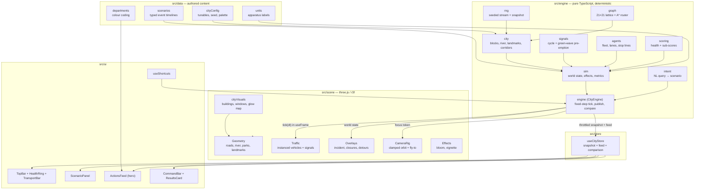

# AI City Brain

A SimCity-style 3D operations dashboard for a city mayor. A procedural night-time
metropolis runs on a real simulation engine; trigger an incident and watch an AI
brain coordinate Fire, Police, Water, Public Works and Transit in a live actions
feed — then flip the **Before AI** switch and watch the same incident run again
with siloed, uncoordinated departments.

Everything is generated procedurally in the browser. No backend, no external 3D
model files, no API keys.

```
┌────────────────────────────────────────────────────────────────────────────┐
│  SCREENSHOT PLACEHOLDER                                                    │
│                                                                            │
│  <!-- Add a capture of the dashboard here:                                  │
│       npm run dev, then open                                               │
│       http://localhost:5173/?scenario=water-main&advance=14&speed=4         │
│       and drop the PNG into docs/screenshot.png, then replace this block    │
│       with:                  │
│  -->                                                                       │
└────────────────────────────────────────────────────────────────────────────┘
```

## What is in it

- **A procedural city** — a 20 × 20 block grid (441 intersections, ~840 road
  segments, ~970 buildings with ~15,000 lit windows), a meandering river with
  illuminated bridge crossings, parks, a transit loop with stations, and six
  civic landmarks (Bay General Hospital, Engine 2 Fire Station, Delta Water
  Treatment, Meridian High School, the Public Works depot and Central Precinct).
- **A live traffic model** — 46 cars, 4 buses, 2 engines, 3 plows, 2 patrol cars
  and 2 utility trucks moving along the road graph with right-hand lane offsets,
  stop-line behaviour at traffic signals, and strobing emergency light bars.
- **A deterministic simulation engine** (`src/engine`) — road graph with A*
  routing, a typed scenario timeline, damage/response metrics, city health
  scoring, and headless replay for comparison.
- **An AI actions feed** — the hero element: every coordinated action the brain
  takes, tagged by department, timestamped against the scenario clock, with
  cross-department hand-offs called out.
- **A command bar** — ask the city a question in plain language and it maps the
  intent onto a scenario, runs it, and shows a Before/After results card.

## Quick start

```bash
npm install
npm run dev          # http://localhost:5173
npm run build        # tsc --noEmit && vite build
```

### Verification

```bash
npm run verify       # headless: every scenario in both modes, asserts the metrics
npm run verify:ui    # server-renders the panels, drives the store, measures CPU cost
node scripts/browser-check.mjs "http://localhost:5173/?scenario=snowstorm&advance=12&speed=4"
                     # optional: drives headless Chrome over CDP against a running dev server
                     # (set CHROME_PATH if Chrome is not in the default macOS location)
```

`npm run verify` is the one to look at first: for all four scenarios it asserts
that the coordinated run reaches the scene faster, resolves sooner, records a
higher health floor and fires cross-department actions that the siloed run never
does.

### Controls

| Input | Action |
| --- | --- |
| `1` – `4` | Trigger Water Main Break / Structure Fire / Snowstorm / Saturday Parade |
| `Space` | Pause and resume the replay |
| `M` | Toggle **After AI** ⇄ **Before AI** (replays the same incident) |
| `R` | Fly back to the isometric home view |
| `/` | Focus the command bar |
| Drag / scroll | Orbit and zoom (angles clamped to a bird's-eye range) |

Deep links are handy for demos and screenshots:

```
/?scenario=water-main            open straight into a replay
/?scenario=snowstorm&speed=4     start at 4x
/?scenario=parade&advance=12     jump 12 simulated minutes in before first paint
```

## Architecture

The simulation is plain TypeScript with **no React and no three.js imports**, so
it can be stepped by the render loop, fast-forwarded headlessly for comparison
cards, or tested in Node. React never sees per-frame state: the 3D scene reads
engine state inside `useFrame`, and the UI subscribes to a throttled snapshot.



### How a frame works

1. `SimulationDriver` (inside the Canvas) calls `cityEngine.tick(delta)` once per
   frame.
2. `CityEngine` converts real seconds into simulated minutes at the selected
   speed (1x / 2x / 4x) and integrates in **fixed 3-simulated-second steps**, so
   the same replay is produced regardless of frame rate.
3. Each step consumes any due scenario events, applies their typed effects
   (incident, detour, dispatch, green wave, pressure, corridor ranking, resolve),
   updates the fleet, attributes arrivals to dispatches, and derives the metrics
   and health score.
4. The engine publishes a snapshot at ~12 Hz, which is all React re-renders on.

### Determinism

The city layout, the fleet and every route come from one seeded PRNG
(`CITY_SEED = 20261013`). Starting a scenario rewinds the fleet to a baseline
snapshot (positions, paths and the RNG state), so a replay — including response
times — is reproducible. `npm run verify` runs the same timeline twice and gets
identical numbers.

### Before AI vs After AI

Both runs share the identical city, fleet and event list. The difference is in
`resolveTimeline` (`src/engine/sim.ts`):

- Events flagged `coordination` are **dropped** in the siloed run — pre-AI,
  nobody had the shared picture that triggered them (transit was not rerouted
  before the closure, hydrant pressure was not boosted before the first engine
  arrived, plows were not ordered by ridership).
- Events with explicit `siloed` overrides happen later and say what actually
  happened (`"Break reported by a resident after water reached the intersection"`).
- Units spend longer on paperwork before rolling (1.6 min vs 0.15 min).
- The same incident lands harder (severity × 1.25) because crews bring the wrong
  gear, and transit loses time at the full rate instead of the mitigated rate
  that a planned detour earns.

Nothing in the comparison card is hard-coded: every number is measured by
fast-forwarding both timelines headlessly (`runHeadless`).

## Scenarios

| # | Scenario | What the brain does |
| --- | --- | --- |
| 1 | **Water Main Break** — a 90-year-old cast-iron main fails under Meridian Crosstown | Detects the pressure drop, sends the repair crew to the exact pipe segment, reroutes Line 1 *before* the next bus departs, signs an 3-block detour, holds 184 students at Meridian High instead of at a flooded stop, then re-baselines the sensors |
| 2 | **Structure Fire** — a four-storey block burning on Row 7 | Four-alarm smoke detection, Engine 2 and Ladder 1 rolling in 15 seconds, a green wave clearing 5 intersections on the response route, hydrant pressure boosted in Sector 3, police perimeter closed, primary search, knockdown, overhaul |
| 3 | **Snowstorm** — a 6 cm/h overnight band | Ranks all six corridors by daily ridership (11,800 down to 2,600), dispatches plows in that order, moves Transit onto a winter timetable, closes the Fairgrounds hill routes, and merges plow telemetry into bus ETA tracking |
| 4 | **Saturday Parade** — a what-if, not an emergency | Simulates 12,400 spectators on Civic Row, forecasts a 4.2 min emergency response penalty, stages Engine 2 inside the route for emergency access, reroutes Line 1 via Fairgrounds with a shuttle, absorbs 38% of block traffic onto the perimeter grid, reopens in waves |

## Project structure

```
src/
├── data/          authored content: tunables, department colours, scenario timelines, units
├── engine/        the simulation — rng, graph+A*, city, signals, agents, scoring, sim, intent, engine facade
├── scene/         three.js layer — visual derivation, geometry, traffic, overlays, camera, effects
├── store/         zustand store: snapshot, feed, comparison
└── ui/            dashboard panels, health ring, actions feed, command bar, results card, shortcuts
scripts/           verification harnesses (engine, UI, browser)
```

## Performance notes

- Every building, window, road, tree, signal and vehicle is an **instanced mesh**
  drawn in a single call per family; the whole city is a few dozen draw calls.
- The render loop **allocates nothing**: matrices, colours and vectors are written
  through shared scratch objects (`src/scene/scratch.ts`), and signal colours are
  only rewritten when a light actually changes.
- Geometry that changes only on discrete events (closures, detours, dispatch
  routes) is rebuilt from a subscription keyed on an overlay signature, not per
  frame.
- Measured on the machine used to build this: a fixed simulation step costs
  **~0.019 ms**, which is ~0.009 ms per rendered frame at 4x speed — about 0.05%
  of a 60 fps budget (`npm run verify:ui` prints the number). The remaining
  budget is the renderer's; frame rate on real hardware was not measured here,
  and the headless browser available in this environment falls back to software
  rendering.

## Future: real data integrations

The engine's seams are deliberate: scenario timelines are data, the fleet is a
plain array, and the world state is a single mutable object. That makes each of
these a drop-in replacement rather than a rewrite.

| Layer | Today | Real integration |
| --- | --- | --- |
| Water network | `pressure` fraction, scripted pipe break | SCADA / EPANET hydraulic model, pressure and acoustic sensors, valve telemetry |
| Road network & traffic | 21×21 lattice, A* over a uniform grid | OSM/OSRM or TomTom/HERE routing, live loop-detector and probe-vehicle speeds, signal controller feeds (SCATS/ATCS) |
| Transit | Crosstown Loop with fixed stops | GTFS static + GTFS-Realtime trip updates, passenger counts per corridor |
| Emergency response | scripted dispatches with ETA estimates | CAD/RMS run cards, unit AVL/GPS, historical response-time models |
| Weather | scripted snowstorm | NWS/OpenWeather forecast feed driving plow routing and signal timing |
| Incidents | authored timelines | 311 reports, 911 dispatch, computer-vision incident detection, social signal fusion |
| Scoring | deterministic sub-score model | weighted KPI model per city charter, back-tested against historical incident outcomes |
| Command bar | lexical keyword/intent matcher | LLM function-calling over the same scenario registry, with the matched plan shown for review |
| 3D fabric | procedural city | digital-twin geometry (CityGML / 3D Tiles / IFC) streamed per district |

Two habits worth keeping when that work starts: scenario timelines stay
declarative and typed, and every metric keeps its headless replay path — that is
what makes a "what-if" defensible to a mayor.

## License

MIT — see [LICENSE](LICENSE).
